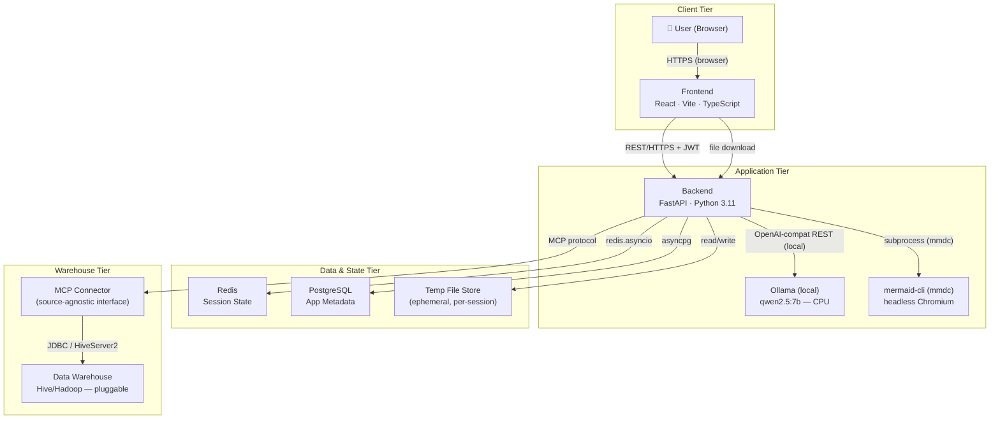

# High-Level Design — NL-to-Data Insight Platform

**Version:** 0.1  
**Date:** 2026-06-30  
**Status:** Draft

---

## 1. System Context Diagram



---

## 2. Component Overview

### 2.1 Frontend (React / Vite / TypeScript)

| Component | Responsibility |
|---|---|
| `ChatPanel` | Multi-turn NL input, message thread display, clarification prompts |
| `SessionHistory` | Lists prior sessions for the logged-in user; allows resumption |
| `OutputDownload` | Shows available export links (chart / PDF / PPT) after each successful query |
| Auth gateway | Stores JWT in memory (not `localStorage`); attaches `Authorization` header to every API call |

### 2.2 Backend (FastAPI)

#### API Layer

| Router | Mount | Responsibility |
|---|---|---|
| `auth.py` | `/auth` | Registration, login (JWT issuance), token refresh |
| `chat.py` | `/chat` | Session lifecycle, NL message ingestion, orchestration entry point |
| `output.py` | `/output` | Authenticated file download via short-lived token |

#### Orchestration Core

| Module | Responsibility |
|---|---|
| `IntentParser` | Single LLM call (Ollama/qwen2.5:7b) to extract entities, metrics, filters, output format, `request_type`, and ambiguity flag |
| `SchemaManager` | Maintains a per-connection schema map sourced from the MCP layer; caches in Redis (5-min TTL) |
| `QueryPlanner` | Maps `ParsedIntent` + `SchemaContext` to a concrete HQL/SQL string; returns a `ClarificationRequest` when the mapping is ambiguous |
| `SessionManager` | CRUD for Redis conversation state; manages download token registry; enforces 24-h TTL |

#### MCP Integration Layer

| Module | Responsibility |
|---|---|
| `MCPConnectorBase` | Abstract interface: `discover_schema`, `execute_query`, `test_connection` |
| `HiveConnector` | Hive/HiveServer2 implementation of the interface |

#### Output Engine

| Module | Responsibility |
|---|---|
| `ChartRenderer` | Converts `QueryResult` → bar / line / pie / table chart → PNG file |
| `MermaidGenerator` | For `structure_query`: LLM produces Mermaid syntax → mmdc subprocess → PNG diagram |
| `PDFGenerator` | Wraps chart + query context in a clean A4 PDF |
| `PPTGenerator` | Produces a `.pptx` with one slide per visual using a plain blank layout |

#### Infrastructure Services

| Service | Role |
|---|---|
| PostgreSQL | User accounts, session metadata records (no result data), audit log |
| Redis | Active conversation state; schema cache; download-token registry |
| Temp FS | Short-lived output files keyed by UUID token; cleaned up on session expiry |

---

## 3. Technology Decisions and Rationale

| Concern | Choice | Rationale |
|---|---|---|
| Backend framework | FastAPI 0.111 | Native `async`/`await`; Pydantic v2 integration; OpenAPI auto-docs; clean DI system |
| LLM provider | Ollama `qwen2.5:7b` (local, CPU) | No cloud API key; single model for all tasks; 4-bit quantised for ~8GB RAM; fast enough for PoC; swap to larger model by changing one env var |
| Diagram generation | `mermaid-cli` (mmdc + headless Chromium) | Structured text diagrams from LLM are more reliable than diffusion-model image generation; deterministic; free |
| MCP abstraction | `MCPConnectorBase` ABC | Source-agnostic from day one; swap Hive → Snowflake/BigQuery by adding one file, no core changes |
| Session state | Redis | Sub-millisecond reads; native key TTL; ideal for ephemeral, non-relational conversation history |
| App database | PostgreSQL + SQLAlchemy async (asyncpg) | ACID guarantees for user/audit data; async driver prevents thread-pool exhaustion |
| Chart generation | `matplotlib` (server-side export) | No headless-browser dependency; deterministic PNG/JPEG output; simple figure API |
| PDF generation | `reportlab` | Pure-Python; zero system dependencies; predictable A4 layout control |
| PowerPoint | `python-pptx` | De-facto Python standard for `.pptx`; blank-layout slides require no template file |
| Auth | JWT HS256 via `python-jose` | Stateless; simple to implement; familiar pattern for future OAuth2 extension |
| Password hashing | `passlib[bcrypt]` | bcrypt is the industry standard for password storage |
| Frontend | React 18 + Vite + TypeScript | Fast HMR in dev; small bundle; strong typing prevents API contract drift |
| HTTP client (FE) | `axios` | Interceptor support for JWT attachment; consistent error handling |
| Containerisation | Docker + `docker-compose` | One-command startup; isolated network; reproducible across machines |

---

## 4. Data Flow Narrative

### 4.1 DATA_QUERY Pipeline (SQL → chart/PDF/PPT)

```
User types NL prompt
│
▼
[1] POST /chat/sessions/{id}/messages  (JWT in Authorization header)
│
▼
[2] SchemaManager.get_schema(connection_id)
    → Checks Redis cache (key: schema:{connection_id}, TTL 5 min)
    → Cache miss? → MCPConnector.discover_schema() → cache result
    → Returns SchemaContext: table names, columns, types
│
▼
[3] IntentParser.parse(prompt, session_history, schema_context)
    → LLM call (qwen2.5:7b via Ollama) with injected schema summary
    → Returns ParsedIntent: entities, metrics, filters, output_format,
      chart_type, needs_clarification, request_type=DATA_QUERY
│
▼
[4] QueryPlanner.plan(intent, schema, user_identity)
    → Second LLM call (qwen2.5:7b) with intent + schema
    → Returns QueryPlan: SQL/HQL string + target tables
│
▼
[5] MCPConnector.execute_query(plan, user_identity)
    → Forwards user identity to warehouse (RBAC/RLS applied there)
    → Returns QueryResult: column names + row data
│
▼
[6] OutputEngine dispatch:
    output_format == "chart"  → ChartRenderer.render() → chart.png
    output_format == "pdf"    → ChartRenderer + PDFGenerator → report.pdf
    output_format == "ppt"    → ChartRenderer + PPTGenerator → deck.pptx
    → File written to /tmp/nl_insight_outputs/{session_id}/{uuid}/
│
▼
[7] SessionManager:
    → register_download_token("{session_id}:{uuid}", DownloadTokenMeta)
    → append_turn(user_turn, assistant_turn with download_token)
    → EXPIRE session key for another 24 h (sliding TTL)
    → write AuditLog row (prompt text, generated query, status, duration)
│
▼
[8] Response → Frontend:
    MessageResponse { role, content, download_token="{session_id}:{uuid}" }
│
▼
[9] User clicks "Download"
    → GET /output/{session_id}:{uuid}  (JWT required)
    → Backend: split compound token, look up session, validate ownership
    → stream file
```

### 4.2 STRUCTURE_QUERY Pipeline (LLM → Mermaid → mmdc → PNG)

```
User asks "Show me an ER diagram"
│
▼
[1] IntentParser classifies request_type=STRUCTURE_QUERY
│
▼
[2] MermaidGenerator.generate(intent, schema, output_path)
    → LLM call (qwen2.5:7b) with schema context + instructions
    → Receives Mermaid syntax (erDiagram, graph TD, classDiagram, etc.)
    → Clean syntax (strip markdown fences)
    → subprocess: mmdc --input diagram.mmd --output diagram.png
    → On mmdc error: retry with error message fed back to LLM (max 2 retries)
    → Returns Path to diagram PNG
│
▼
[3] Register compound download token
│
▼
[4] Response → Frontend:
    MessageResponse { download_token="{session_id}:{uuid}", output_format="chart" }
│
▼
[5] User clicks "Download" → receives diagram.png
```

---

## 5. Security Architecture

### 5.1 Authentication Flow

```
User credentials (username + password)
         │
         ▼
    POST /auth/token
         │
    verify password hash (bcrypt)
         │
    issue JWT { sub: user_id, exp: now+8h, jti: uuid }
         │
    client stores JWT in-memory (not localStorage)
         │
    every subsequent request: Authorization: Bearer <token>
         │
    FastAPI dependency (get_current_user):
        - decodes JWT (HS256)
        - verifies exp
        - loads user from PostgreSQL
```

### 5.2 Identity Passthrough

Every call to `MCPConnector.execute_query()` receives a `UserIdentity` object populated from the JWT:

```
JWT payload
    → user_id, username, roles, raw_jwt
    → passed as-is to MCPConnector
    → HiveConnector forwards to HiveServer2 as impersonation principal
    → Warehouse-level RBAC/RLS applies before any row is returned
```

The application layer **never sees rows the user is not authorized to see**. Authorization is enforced at the warehouse, not the app.

### 5.3 Session & Token Lifecycle

| Object | TTL | Mechanism |
|---|---|---|
| JWT access token | 8 hours | `exp` claim; refresh via `/auth/refresh` |
| Redis session | 24 hours (sliding) | `EXPIRE` reset on every `SessionManager` write |
| Download token | Session lifetime | Stored in Redis session; expires with session |
| Schema cache | 5 minutes | Separate Redis key `schema:{connection_id}` with TTL |
| Temp output files | Session lifetime | Cleaned up by background task when session key expires |

### 5.4 Transport Security

- All external traffic is TLS-terminated at the reverse proxy / load balancer
- The docker-compose internal network (`insight_net`) is isolated; only the frontend and backend ports are exposed on the host
- Secrets are injected via environment variables; `.env` is `.gitignore`d
- API docs (`/docs`, `/redoc`) are disabled in production

### 5.5 Output File Access Control

- Each generated file is assigned a cryptographically random UUID `download_token`
- The token is stored in Redis under the user's session — it cannot be guessed or transferred
- `/output/{token}` validates that the requesting JWT `user_id` matches the session owner before streaming

---

## 6. Scalability and Extensibility

### PoC Targets (single instance)

| Metric | Target | Mechanism |
|---|---|---|
| Concurrent users | ~10 | FastAPI async handles I/O-bound concurrency; LLM calls are awaited, not blocking |
| Schema size | < 20 tables | Schema injected into LLM prompt; no chunking needed at PoC scale |
| End-to-end latency | < 30 s | LLM calls ~5–8 s; query execution < 20 s (25 s timeout); output gen < 2 s |
| Session turns | ≥ 3 follow-ups | Full history injected into every LLM call; Redis holds up to 24 h |

### Horizontal Scaling Path (post-PoC)

| Layer | Change needed |
|---|---|
| Backend | Already stateless (state in Redis) → add replicas behind a load balancer |
| Session state | No change — Redis is shared across replicas |
| Output files | Replace local temp FS with S3-compatible object storage; update `OutputEngine` to write/presign from S3 |
| Schema cache | No change — already in Redis |
| LLM calls | Already async → throughput scales linearly with replicas |

### Adding a New MCP Connector

The core orchestration layer never imports a concrete connector — only the abstract `MCPConnectorBase`. To add, e.g., a Snowflake connector:

1. Create `backend/app/mcp/snowflake_connector.py`
2. Inherit from `MCPConnectorBase`
3. Implement `discover_schema()`, `execute_query()`, `test_connection()`, and `close()`
4. Add `"snowflake"` to `ConnectorType` enum in `config.py`
5. Add a branch in the `get_mcp_connector()` factory in `api/deps.py`
6. Add `SNOWFLAKE_*` env vars to `.env.example`
7. No changes to `IntentParser`, `QueryPlanner`, `SessionManager`, or any route

---

## 7. Non-Functional Requirements Mapping

| NFR | Implementation |
|---|---|
| End-to-end response < 30 s | Async throughout; MCP query timeout 25 s; LLM timeout 20 s |
| ~10 concurrent users | Single async FastAPI instance; uvicorn with multiple workers if needed |
| Encryption in transit | TLS at proxy; Anthropic API already HTTPS; internal net isolated |
| No result data persistence | Redis holds rows only during active response processing (not stored); PostgreSQL stores query text and metadata only |
| Source-agnostic MCP | `MCPConnectorBase` ABC enforced; factory pattern in `deps.py` |
| Multi-turn (≥ 3 turns) | Full `ConversationTurn` history stored in Redis and injected into every LLM call |
| Ambiguity handling | `IntentParser` returns `needs_clarification: True` + question; no query is generated or executed |
| Format from NL | `ParsedIntent.output_format` extracted by LLM; `None` triggers clarification response |
| RBAC/RLS enforcement | `UserIdentity` forwarded on every `execute_query()` call; app cannot bypass warehouse auth |
| All endpoints authenticated | `get_current_user` dependency on all non-`/auth` routes |
