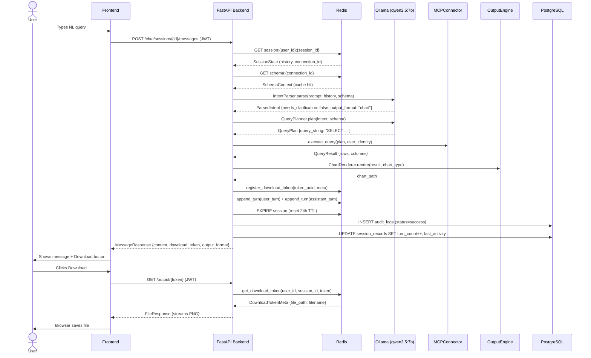
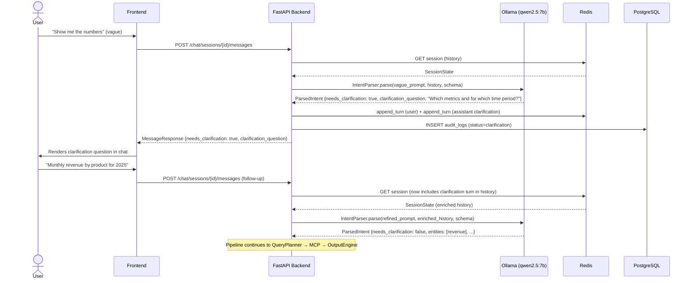
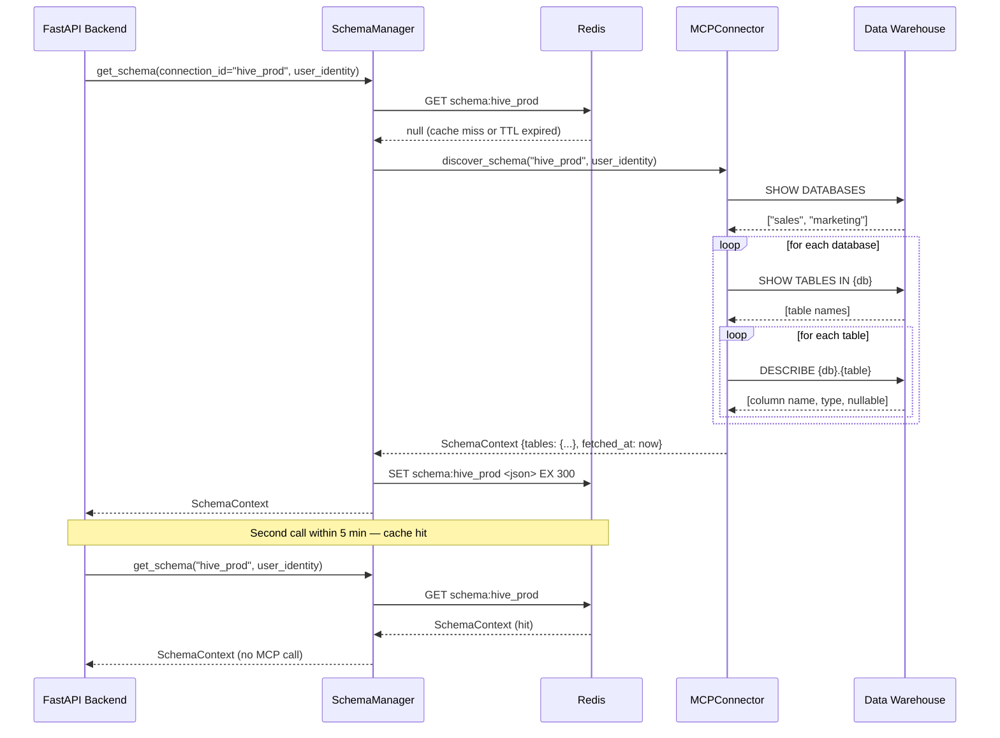

# Low-Level Design — NL-to-Data Insight Platform

**Version:** 0.1  
**Date:** 2026-06-30  
**Status:** Draft

---

## 1. Module Breakdown

| Module | Path | Responsibility |
|---|---|---|
| App factory | `app/main.py` | Creates FastAPI instance, mounts routers, manages lifespan |
| Settings | `app/config.py` | Pydantic-settings model; single source of truth for all env config |
| Auth routes | `app/api/routes/auth.py` | `/auth/register`, `/auth/token`, `/auth/refresh` |
| Chat routes | `app/api/routes/chat.py` | Session CRUD + NL message ingestion → full pipeline orchestration |
| Output routes | `app/api/routes/output.py` | Token-validated file download |
| Dependencies | `app/api/deps.py` | FastAPI `Depends` factories: DB session, Redis client, current user, connectors |
| Intent parser | `app/core/intent_parser.py` | LLM call → `ParsedIntent`; holds editable prompt template constant |
| Schema manager | `app/core/schema_manager.py` | Schema discovery via MCP; Redis-backed cache; TTL management |
| Query planner | `app/core/query_planner.py` | LLM call → `QueryPlan` or `ClarificationRequest`; editable prompt template |
| Session manager | `app/core/session_manager.py` | Redis CRUD for `SessionState`; download token registry; sliding TTL |
| MCP base | `app/mcp/base.py` | `MCPConnectorBase` ABC + `UserIdentity` / `QueryResult` dataclasses |
| Hive connector | `app/mcp/hive_connector.py` | `MCPConnectorBase` implementation for HiveServer2 via `pyhive` |
| Chart renderer | `app/output/chart.py` | `QueryResult` → bar / line / pie / table → PNG file via matplotlib |
| Mermaid generator | `app/output/mermaid_gen.py` | `structure_query`: LLM → Mermaid syntax → mmdc subprocess → PNG diagram |
| PDF generator | `app/output/pdf_gen.py` | chart + metadata → A4 PDF via reportlab |
| PPT generator | `app/output/ppt_gen.py` | chart + data → `.pptx` via python-pptx |
| DB models | `app/models/db.py` | SQLAlchemy async ORM: `User`, `SessionRecord`, `AuditLog` |
| Pydantic schemas | `app/models/schemas.py` | All request/response Pydantic models + internal dataclasses |
| Security utils | `app/utils/security.py` | JWT creation/verification; bcrypt password helpers |

---

## 2. Class and Function Signatures

### 2.1 `app/models/schemas.py` — Shared Types

```python
# --- Enums ---

class OutputFormat(str, Enum):
    CHART = "chart"
    PDF   = "pdf"
    PPT   = "ppt"

class ChartType(str, Enum):
    BAR   = "bar"
    LINE  = "line"
    PIE   = "pie"
    TABLE = "table"

class MessageRole(str, Enum):
    USER      = "user"
    ASSISTANT = "assistant"

class RequestType(str, Enum):
    DATA_QUERY      = "data_query"       # user wants to query actual data
    STRUCTURE_QUERY = "structure_query"  # user wants schema/model diagram

class AuditStatus(str, Enum):
    SUCCESS       = "success"
    CLARIFICATION = "clarification"
    ERROR         = "error"

# --- Internal Dataclasses (not API-facing) ---

@dataclass
class ColumnMeta:
    name:        str
    data_type:   str
    nullable:    bool
    description: str | None = None

@dataclass
class TableMeta:
    name:              str
    database:          str
    columns:           list[ColumnMeta]
    description:       str | None = None
    row_count_estimate: int | None = None

@dataclass
class SchemaContext:
    tables:         dict[str, TableMeta]   # key: fully-qualified "db.table"
    fetched_at:     datetime
    connector_type: str

@dataclass
class ParsedIntent:
    entities:               list[str]          # business entities / table hints
    metrics:                list[str]          # columns / aggregations requested
    filters:                dict[str, Any]     # WHERE conditions (key=column, value=filter)
    time_range:             str | None         # e.g. "last quarter", "Q1 2025"
    output_format:          OutputFormat | None
    chart_type:             ChartType | None
    needs_clarification:    bool
    clarification_question: str | None
    request_type:           RequestType = field(default=RequestType.DATA_QUERY)

@dataclass
class QueryPlan:
    query_string:         str
    target_tables:        list[str]
    estimated_complexity: Literal["low", "medium", "high"]
    parameters:           dict[str, Any]

@dataclass
class ClarificationRequest:
    question: str
    options:  list[str] | None = None

@dataclass
class DownloadTokenMeta:
    file_path:     str
    output_format: OutputFormat
    filename:      str
    expires_at:    datetime

@dataclass
class ConversationTurn:
    role:           MessageRole
    content:        str
    timestamp:      datetime
    query_plan:     QueryPlan | None       = None
    download_token: str | None             = None

@dataclass
class SessionState:
    session_id:      str
    user_id:         str
    connection_id:   str
    history:         list[ConversationTurn]
    download_tokens: dict[str, DownloadTokenMeta]   # token_uuid → meta
    created_at:      datetime
    last_activity:   datetime

# --- Pydantic API Schemas ---

class RegisterRequest(BaseModel):
    username: str = Field(..., min_length=3, max_length=64)
    email:    EmailStr
    password: str = Field(..., min_length=8)

class UserResponse(BaseModel):
    id:         UUID
    username:   str
    email:      EmailStr
    is_active:  bool
    created_at: datetime
    model_config = ConfigDict(from_attributes=True)

class TokenResponse(BaseModel):
    access_token: str
    token_type:   str = "bearer"
    expires_in:   int               # seconds

class CreateSessionRequest(BaseModel):
    connection_id: str = Field(..., description="MCP connector connection identifier")

class SessionSummary(BaseModel):
    session_id:    str
    connection_id: str
    created_at:    datetime
    last_activity: datetime
    turn_count:    int

class SessionDetailResponse(BaseModel):
    session_id:    str
    connection_id: str
    history:       list["MessageResponse"]
    created_at:    datetime
    last_activity: datetime

class SessionResponse(BaseModel):
    session_id:    str
    connection_id: str
    created_at:    datetime

class MessageRequest(BaseModel):
    content: str = Field(..., min_length=1, max_length=4096)

class MessageResponse(BaseModel):
    role:                   MessageRole
    content:                str
    needs_clarification:    bool = False
    clarification_question: str | None = None
    download_token:         str | None = None
    output_format:          OutputFormat | None = None
    timestamp:              datetime
```

---

### 2.2 `app/utils/security.py`

```python
pwd_context = CryptContext(schemes=["bcrypt"], deprecated="auto")

def create_access_token(
    data: dict[str, Any],
    expires_delta: timedelta | None = None,
    settings: Settings | None = None,
) -> str:
    """Sign and return a JWT. `data` must include `sub` (user_id str)."""

def verify_token(token: str, settings: Settings) -> dict[str, Any]:
    """Decode and validate a JWT. Raises HTTPException 401 on failure."""

def get_password_hash(password: str) -> str:
    """Return bcrypt hash of a plaintext password."""

def verify_password(plain_password: str, hashed_password: str) -> bool:
    """Return True if plain_password matches the stored hash."""
```

---

### 2.3 `app/core/intent_parser.py`

```python
# Editable prompt template — modify this constant to tune LLM behaviour
INTENT_EXTRACTION_PROMPT: str = """
You are a data analyst assistant. Given a user's natural-language query and the
warehouse schema below, extract a structured intent.

## Warehouse Schema
{schema_summary}

## Conversation History
{history_summary}

## User Query
{user_prompt}

Respond ONLY with a JSON object matching this schema:
{{
  "request_type": "<data_query|structure_query>",
  "entities": ["<table or business entity>"],
  "metrics": ["<column or aggregation>"],
  "filters": {{"<column>": "<value>"}},
  "time_range": "<string or null>",
  "output_format": "<chart|pdf|ppt|null>",
  "chart_type": "<bar|line|pie|table|null>",
  "needs_clarification": <true|false>,
  "clarification_question": "<string or null>"
}}

Use "structure_query" when the user asks for a diagram, ER model, schema view,
relationship map, or class diagram. Use "data_query" for all other requests.
"""

class IntentParser:
    def __init__(self, llm_provider: LLMProviderBase, settings: Settings) -> None: ...

    async def parse(
        self,
        user_prompt: str,
        conversation_history: list[ConversationTurn],
        schema_context: SchemaContext,
    ) -> ParsedIntent:
        """
        Call Claude to extract structured intent from a natural-language prompt.

        Returns ParsedIntent with needs_clarification=True if the prompt is
        too vague to map to the schema.
        """

    def _build_schema_summary(self, schema: SchemaContext) -> str:
        """Render SchemaContext as a compact text summary for prompt injection."""

    def _build_history_summary(self, history: list[ConversationTurn]) -> str:
        """Render conversation history as an ordered list for prompt injection."""

    def _parse_llm_response(self, raw: str) -> ParsedIntent:
        """Deserialise the LLM's JSON output into a ParsedIntent dataclass."""
```

---

### 2.4 `app/core/schema_manager.py`

```python
SCHEMA_CACHE_KEY_PATTERN: str = "schema:{connection_id}"

class SchemaManager:
    def __init__(
        self,
        mcp_connector: MCPConnectorBase,
        redis_client: Redis,
        cache_ttl_seconds: int = 300,
    ) -> None: ...

    async def get_schema(
        self,
        connection_id: str,
        user_identity: UserIdentity,
        force_refresh: bool = False,
    ) -> SchemaContext:
        """
        Return schema for the given connection.
        Hits Redis cache first; falls back to MCP discover_schema().
        """

    async def _fetch_from_mcp(
        self, connection_id: str, user_identity: UserIdentity
    ) -> SchemaContext: ...

    async def _load_from_cache(self, connection_id: str) -> SchemaContext | None: ...

    async def _save_to_cache(
        self, connection_id: str, schema: SchemaContext
    ) -> None: ...
```

---

### 2.5 `app/core/query_planner.py`

```python
# Editable prompt template
QUERY_GENERATION_PROMPT: str = """
You are an expert HQL/SQL query writer. Given the structured intent and warehouse
schema below, generate a single, correct, read-only HQL query.

## Warehouse Schema
{schema_summary}

## Parsed Intent
{intent_json}

Rules:
- Only generate SELECT queries. Never INSERT, UPDATE, DELETE, or DDL.
- Use fully-qualified table names: database.table.
- Apply all filters in the WHERE clause.
- If the intent cannot be mapped unambiguously, set needs_clarification=true.

Respond ONLY with a JSON object:
{{
  "query_string": "<HQL/SQL or null>",
  "target_tables": ["<table>"],
  "estimated_complexity": "<low|medium|high>",
  "parameters": {{}},
  "needs_clarification": <true|false>,
  "clarification_question": "<string or null>"
}}
"""

class QueryPlanner:
    def __init__(self, llm_provider: LLMProviderBase, settings: Settings) -> None: ...

    async def plan(
        self,
        intent: ParsedIntent,
        schema: SchemaContext,
        user_identity: UserIdentity,
    ) -> QueryPlan | ClarificationRequest:
        """
        Generate a QueryPlan from a ParsedIntent.
        Returns ClarificationRequest when the intent cannot be mapped to schema.
        """

    def _parse_llm_response(
        self, raw: str
    ) -> QueryPlan | ClarificationRequest: ...
```

---

### 2.6 `app/core/session_manager.py`

```python
SESSION_KEY_PATTERN: str = "session:{user_id}:{session_id}"

class SessionManager:
    SESSION_TTL_SECONDS: int = 86400   # 24 h sliding window

    def __init__(self, redis_client: Redis) -> None: ...

    async def create_session(
        self,
        user_id: str,
        connection_id: str,
    ) -> SessionState:
        """Create a new session, persist to Redis, return state."""

    async def get_session(
        self,
        user_id: str,
        session_id: str,
    ) -> SessionState | None:
        """Load session from Redis. Returns None if not found or expired."""

    async def save_session(self, state: SessionState) -> None:
        """Serialize and persist session to Redis; resets TTL."""

    async def append_turn(
        self,
        user_id: str,
        session_id: str,
        turn: ConversationTurn,
    ) -> None:
        """Add a single conversation turn and persist."""

    async def register_download_token(
        self,
        user_id: str,
        session_id: str,
        token: str,
        meta: DownloadTokenMeta,
    ) -> None:
        """Store a download token in the session's token registry."""

    async def get_download_token(
        self,
        user_id: str,
        session_id: str,
        token: str,
    ) -> DownloadTokenMeta | None:
        """Retrieve download token metadata; returns None if missing or expired."""

    async def delete_session(self, user_id: str, session_id: str) -> None:
        """Delete session key from Redis; triggers file cleanup."""

    def _make_key(self, user_id: str, session_id: str) -> str:
        """Return `session:{user_id}:{session_id}`."""
```

---

### 2.7 `app/mcp/base.py`

```python
@dataclass
class UserIdentity:
    user_id:  str
    username: str
    roles:    list[str]
    raw_jwt:  str          # forwarded to warehouse for impersonation / RBAC

@dataclass
class QueryResult:
    columns:          list[str]
    rows:             list[dict[str, Any]]
    row_count:        int
    execution_time_ms: int

class MCPConnectorBase(ABC):
    """
    Abstract interface for all warehouse MCP connectors.

    Every concrete connector must implement exactly these three methods.
    The rest of the application interacts exclusively through this interface,
    ensuring source-agnosticism.
    """

    @abstractmethod
    async def discover_schema(
        self,
        connection_id: str,
        user_identity: UserIdentity,
    ) -> "SchemaContext":
        """
        Introspect the warehouse and return its schema.
        Must respect warehouse-level access control for user_identity.
        Must complete within 10 seconds.
        """

    @abstractmethod
    async def execute_query(
        self,
        query: "QueryPlan",
        user_identity: UserIdentity,
        timeout_seconds: int = 25,
    ) -> QueryResult:
        """
        Execute a read-only query and return results.
        Must forward user_identity for RBAC/RLS.
        Raises QueryTimeoutError if timeout_seconds is exceeded.
        Raises QueryExecutionError on warehouse-side failures.
        Must NOT cache results.
        """

    @abstractmethod
    async def test_connection(
        self,
        connection_id: str,
        user_identity: UserIdentity,
    ) -> bool:
        """Lightweight liveness check. Returns True if connectable."""

    @abstractmethod
    async def close(self) -> None:
        """Release all open connections and resources."""

class QueryTimeoutError(Exception):
    """Raised when execute_query exceeds timeout_seconds."""

class QueryExecutionError(Exception):
    """Raised on warehouse-side query failures."""

class SchemaDiscoveryError(Exception):
    """Raised when discover_schema cannot introspect the warehouse."""
```

---

### 2.8 `app/output/chart.py`

```python
class ChartRenderer:
    DEFAULT_FIGURE_SIZE: tuple[int, int] = (12, 6)
    DEFAULT_DPI: int = 150

    async def render(
        self,
        result: QueryResult,
        chart_type: ChartType,
        title: str,
        output_path: Path,
        image_format: Literal["png", "jpeg"] = "png",
    ) -> Path:
        """
        Render QueryResult as a chart image and save to output_path.
        Returns output_path on success.
        Raises ChartRenderError if result is empty or incompatible with chart_type.
        """

    def _render_bar(self, ax: "Axes", result: QueryResult, title: str) -> None: ...
    def _render_line(self, ax: "Axes", result: QueryResult, title: str) -> None: ...
    def _render_pie(self, ax: "Axes", result: QueryResult, title: str) -> None: ...
    def _render_table(self, ax: "Axes", result: QueryResult, title: str) -> None: ...
    def _dataframe_from_result(self, result: QueryResult) -> "pd.DataFrame": ...

class ChartRenderError(Exception):
    """Raised when chart rendering fails."""
```

---

### 2.9 `app/output/mermaid_gen.py`

```python
MERMAID_GENERATION_PROMPT: str = """
You are a database architect. Given the warehouse schema below and the user's
question, produce a Mermaid diagram that best answers the question.

## Warehouse Schema
{schema_summary}

## User Question
{user_prompt}

{error_feedback}

Choose the most appropriate diagram type:
  - erDiagram       — entity relationships between tables
  - graph TD        — data flow or dependency graphs
  - classDiagram    — OOP-style class/attribute view

Output ONLY valid Mermaid syntax. No markdown fences, no explanation.
"""

class MermaidGenerator:
    MMDC_TIMEOUT: int = 30      # seconds
    MAX_RETRIES: int  = 2

    def __init__(self, llm_provider: LLMProviderBase) -> None: ...

    async def generate(
        self,
        intent: ParsedIntent,
        schema: SchemaContext,
        output_path: Path,
    ) -> Path:
        """
        LLM → Mermaid syntax → mmdc subprocess → PNG.

        Retries up to MAX_RETRIES times, feeding mmdc error messages back to
        the LLM on each attempt. Raises RuntimeError if all retries fail.
        Returns output_path on success.
        """

    def _clean_syntax(self, raw: str) -> str:
        """Strip markdown code fences (```mermaid ... ```) if present."""

    def _render_sync(self, syntax: str, output_path: Path) -> str | None:
        """
        Write .mmd to a temp file and call mmdc via subprocess.
        Uses a puppeteer config file with --no-sandbox for Docker compatibility.
        Returns None on success, error string on failure.
        """
```

---

### 2.10 `app/output/pdf_gen.py`

```python
class PDFGenerator:
    PAGE_SIZE: tuple = A4
    MARGIN_PT: int = 72   # 1 inch

    async def generate(
        self,
        result: QueryResult,
        chart_path: Path | None,
        title: str,
        query_context: str,
        output_path: Path,
    ) -> Path:
        """
        Generate an A4 PDF containing:
          - Title and generation timestamp
          - query_context string (the HQL/SQL or prompt summary)
          - Embedded chart image (if chart_path provided)
          - Tabular data (first 50 rows)
        Returns output_path on success.
        """
```

---

### 2.11 `app/output/ppt_gen.py`

```python
class PPTGenerator:
    SLIDE_WIDTH_EMU: int  = 9144000   # 10 inches
    SLIDE_HEIGHT_EMU: int = 5143500   # 7.5 inches
    BLANK_LAYOUT_INDEX: int = 6

    async def generate(
        self,
        result: QueryResult,
        chart_path: Path | None,
        title: str,
        output_path: Path,
    ) -> Path:
        """
        Generate a .pptx with:
          Slide 1 — title slide (title + timestamp)
          Slide 2 — chart image (if provided)
          Slide 3 — data table (up to 20 rows)
        Returns output_path on success.
        """

    def _add_title_slide(self, prs: "Presentation", title: str) -> None: ...
    def _add_chart_slide(self, prs: "Presentation", chart_path: Path) -> None: ...
    def _add_table_slide(self, prs: "Presentation", result: QueryResult) -> None: ...
```

---

## 3. FastAPI Route Definitions

### `/auth` — Authentication

| Method | Path | Auth | Request Body | Response | Notes |
|---|---|---|---|---|---|
| `POST` | `/auth/register` | None | `RegisterRequest` | `UserResponse` (201) | Hashes password; creates user row |
| `POST` | `/auth/token` | None | `OAuth2PasswordRequestForm` | `TokenResponse` (200) | Issues HS256 JWT (8 h) |
| `POST` | `/auth/refresh` | Bearer | — | `TokenResponse` (200) | Requires valid non-expired token |

### `/chat` — Conversation & Orchestration

| Method | Path | Auth | Request Body | Response | Notes |
|---|---|---|---|---|---|
| `POST` | `/chat/sessions` | Bearer | `CreateSessionRequest` | `SessionResponse` (201) | Creates Redis session + PostgreSQL `session_records` row |
| `GET` | `/chat/sessions` | Bearer | — | `list[SessionSummary]` (200) | Reads from PostgreSQL (metadata only) |
| `GET` | `/chat/sessions/{session_id}` | Bearer | — | `SessionDetailResponse` (200) | Reads full history from Redis |
| `POST` | `/chat/sessions/{session_id}/messages` | Bearer | `MessageRequest` | `MessageResponse` (200) | Full pipeline entry point |
| `DELETE` | `/chat/sessions/{session_id}` | Bearer | — | `204 No Content` | Deletes Redis key + marks session closed in PG |

### `/output` — File Download

| Method | Path | Auth | Request Body | Response | Notes |
|---|---|---|---|---|---|
| `GET` | `/output/{download_token}` | Bearer | — | `FileResponse` (200) | Validates token ownership, streams file |

---

## 4. Redis Session Data Structure

### Key Namespace

| Key pattern | Contents | TTL |
|---|---|---|
| `session:{user_id}:{session_id}` | `SessionState` (JSON) | 24 h sliding |
| `schema:{connection_id}` | `SchemaContext` (JSON) | 5 min fixed |

### `SessionState` JSON Payload

```json
{
  "session_id": "ses_a1b2c3d4",
  "user_id": "usr_11223344",
  "connection_id": "hive_prod",
  "history": [
    {
      "role": "user",
      "content": "Show total sales by region last quarter",
      "timestamp": "2026-06-30T10:00:00Z",
      "query_plan": null,
      "download_token": null
    },
    {
      "role": "assistant",
      "content": "Here is the regional sales breakdown for Q1 2026...",
      "timestamp": "2026-06-30T10:00:09Z",
      "query_plan": {
        "query_string": "SELECT region, SUM(amount) AS total_sales FROM sales.transactions WHERE quarter='Q1' AND year=2026 GROUP BY region ORDER BY total_sales DESC",
        "target_tables": ["sales.transactions"],
        "estimated_complexity": "low",
        "parameters": {}
      },
      "download_token": "tok_f9e8d7c6"
    }
  ],
  "download_tokens": {
    "tok_f9e8d7c6": {
      "file_path": "/tmp/nl_insight_outputs/ses_a1b2c3d4/chart_f9e8d7c6.png",
      "output_format": "chart",
      "filename": "sales_by_region_q1_2026.png",
      "expires_at": "2026-07-01T10:00:00Z"
    }
  },
  "created_at": "2026-06-30T10:00:00Z",
  "last_activity": "2026-06-30T10:00:09Z"
}
```

### Session Write Protocol

Every call to `SessionManager.save_session()` must:
1. Serialize state to JSON
2. `SET session:{user_id}:{session_id} <json>`
3. `EXPIRE session:{user_id}:{session_id} 86400` (resets sliding TTL)

---

## 5. PostgreSQL Schema

```sql
-- Enable UUID generation
CREATE EXTENSION IF NOT EXISTS "pgcrypto";

-- ── Users ────────────────────────────────────────────────────────────────────
CREATE TABLE users (
    id               UUID        PRIMARY KEY DEFAULT gen_random_uuid(),
    username         VARCHAR(64) UNIQUE NOT NULL,
    email            VARCHAR(255) UNIQUE NOT NULL,
    hashed_password  VARCHAR(255) NOT NULL,
    is_active        BOOLEAN     NOT NULL DEFAULT TRUE,
    roles            TEXT[]      NOT NULL DEFAULT '{}',
    created_at       TIMESTAMPTZ NOT NULL DEFAULT NOW(),
    updated_at       TIMESTAMPTZ NOT NULL DEFAULT NOW()
);

-- ── Session Records (metadata only — no result data) ─────────────────────────
CREATE TABLE session_records (
    id               UUID        PRIMARY KEY DEFAULT gen_random_uuid(),
    user_id          UUID        NOT NULL REFERENCES users(id) ON DELETE CASCADE,
    redis_session_id VARCHAR(64) NOT NULL UNIQUE,
    connection_id    VARCHAR(128) NOT NULL,
    created_at       TIMESTAMPTZ NOT NULL DEFAULT NOW(),
    last_activity    TIMESTAMPTZ NOT NULL DEFAULT NOW(),
    closed_at        TIMESTAMPTZ,
    turn_count       INTEGER     NOT NULL DEFAULT 0
);

CREATE INDEX idx_session_records_user_id ON session_records(user_id);
CREATE INDEX idx_session_records_last_activity ON session_records(last_activity DESC);

-- ── Audit Log ────────────────────────────────────────────────────────────────
-- Stores the query generated and metadata. NEVER stores result rows.
CREATE TABLE audit_logs (
    id               UUID        PRIMARY KEY DEFAULT gen_random_uuid(),
    user_id          UUID        NOT NULL REFERENCES users(id) ON DELETE CASCADE,
    session_id       UUID        REFERENCES session_records(id) ON DELETE SET NULL,
    prompt_text      TEXT        NOT NULL,
    generated_query  TEXT,                        -- HQL/SQL generated (not results)
    output_format    VARCHAR(16),
    connection_id    VARCHAR(128),
    status           VARCHAR(32) NOT NULL,         -- success | clarification | error
    error_message    TEXT,
    duration_ms      INTEGER,
    created_at       TIMESTAMPTZ NOT NULL DEFAULT NOW()
);

CREATE INDEX idx_audit_logs_user_id ON audit_logs(user_id);
CREATE INDEX idx_audit_logs_session_id ON audit_logs(session_id);
CREATE INDEX idx_audit_logs_created_at ON audit_logs(created_at DESC);
CREATE INDEX idx_audit_logs_status ON audit_logs(status);
```

---

## 6. MCP Client Interface Contract

### Abstract Methods

#### `discover_schema(connection_id, user_identity) -> SchemaContext`
- Introspects all databases/tables/columns visible to `user_identity`
- Must not return tables the user cannot access (warehouse enforces this)
- Must complete within 10 seconds; raise `SchemaDiscoveryError` on failure
- Callers should not call this more than once per cache TTL; `SchemaManager` handles caching

#### `execute_query(query, user_identity, timeout_seconds) -> QueryResult`
- Forwards `user_identity.raw_jwt` or `user_identity.username` for warehouse impersonation
- Enforces `timeout_seconds`; raises `QueryTimeoutError` on breach
- Raises `QueryExecutionError` with the warehouse error message on failure
- Returns rows as `list[dict[str, Any]]` — column names are the dict keys
- **Never caches results** — every call hits the warehouse

#### `test_connection(connection_id, user_identity) -> bool`
- Lightweight check (e.g., `SELECT 1`)
- Returns `True` on success, `False` on connection refusal
- Raises no exceptions — errors are swallowed and logged

#### `close() -> None`
- Releases all pooled connections and async resources
- Called on application shutdown (lifespan teardown)

### Adding a New Connector — Checklist

```
1. Create:  backend/app/mcp/{name}_connector.py
2. Class:   class {Name}Connector(MCPConnectorBase)
3. Implement: discover_schema(), execute_query(), test_connection(), close()
4. Enum:    Add "{name}" to ConnectorType in config.py
5. Factory: Add branch in get_mcp_connector() in api/deps.py
6. Env:     Document new {NAME}_* env vars in .env.example
7. Tests:   Add tests/test_{name}_connector.py
8. No changes to any core/ or api/routes/ module required
```

---

## 7. Output Generation Pipeline

```
ParsedIntent.request_type
      │
      ├─── STRUCTURE_QUERY
      │         │
      │         └──► MermaidGenerator.generate(intent, schema, output_path)
      │                   ├── LLM call (qwen2.5:7b) → Mermaid syntax
      │                   ├── _clean_syntax() → strip fences
      │                   └── _render_sync() → mmdc → diagram.png
      │                             └──► register_download_token("{session_id}:{uuid}")
      │
      └─── DATA_QUERY
                │
                └── QueryResult  +  ParsedIntent.output_format
                          │
                          ├─── output_format == OutputFormat.CHART
                          │         └──► ChartRenderer.render() → chart.png
                          │                   └──► register_download_token("{session_id}:{uuid}")
                          │
                          ├─── output_format == OutputFormat.PDF
                          │         ├──► ChartRenderer.render() → chart.png
                          │         └──► PDFGenerator.generate() → report.pdf
                          │                   └──► register_download_token("{session_id}:{uuid}")
                          │
                          └─── output_format == OutputFormat.PPT
                                    ├──► ChartRenderer.render() → chart.png
                                    └──► PPTGenerator.generate() → report.pptx
                                              └──► register_download_token("{session_id}:{uuid}")

File path convention:
  {OUTPUT_TEMP_DIR}/{session_id}/{token_uuid}/{filename}

Download token format: "{session_id}:{token_uuid}"
  - output.py splits on first ":" to get session_id → looks up session in Redis
  - token_uuid is the key within session.download_tokens

Download flow:
  GET /output/{session_id}:{token_uuid}
      → get_current_user()                          # validate JWT
      → split compound token → session_id, uuid
      → SessionManager.get_download_token()         # validate ownership + get path
      → FileResponse(path, filename=meta.filename)
```

---

## 8. Error Handling Strategy

| Layer | Condition | HTTP Code | Action |
|---|---|---|---|
| Auth | Missing / malformed JWT | 401 | Return `WWW-Authenticate: Bearer` header |
| Auth | Expired JWT | 401 | Prompt client to call `/auth/refresh` |
| Auth | Wrong password | 401 | Generic "incorrect credentials" (no enumeration) |
| Auth | Duplicate username/email | 409 | Return field-level conflict detail |
| Intent Parser | LLM API error | 503 | Retry once (exponential backoff 1 s); fail to 503 |
| Intent Parser | Vague prompt | 200 | Return `needs_clarification: true` in response |
| Schema Manager | MCP unreachable | 503 | Return stale cached schema if available; else 503 |
| Query Planner | Unmappable intent | 200 | Return `needs_clarification: true` |
| Query Planner | LLM API error | 503 | Retry once; fail to 503 |
| MCP Execution | `QueryTimeoutError` | 504 | Return timeout message to user |
| MCP Execution | `QueryExecutionError` | 422 | Return warehouse error message (sanitised) |
| MCP Execution | RBAC / auth failure | 403 | "Access denied by the data warehouse" |
| Output Engine | `ChartRenderError` | 500 | Log + return 500; include session/request ID |
| Redis | Connection failure | 503 | Log CRITICAL; return 503 to all chat endpoints |
| PostgreSQL | Connection failure | 503 | Log CRITICAL; return 503 |
| Download | Unknown token | 404 | Token not found |
| Download | Token / session mismatch | 403 | User does not own this token |

All errors write an `AuditLog` row with `status = AuditStatus.ERROR` and `error_message`.

---

## 9. Sequence Diagrams

### 9a. Happy Path — NL Prompt to File Download



---

### 9b. Ambiguous Prompt — Clarification Loop



---

### 9c. Schema Discovery on New or Stale Connection


